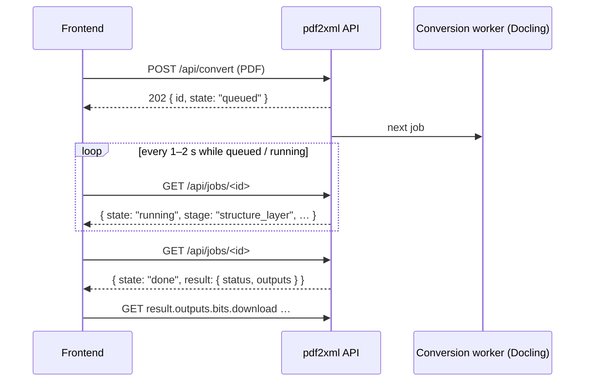

# pdf2xml conversion API

The container converts an uploaded PDF to:

- canonical JSON;
- canonical XML (S4C XML);
- BITS 2.2;
- JATS 1.4.

The frontend uploads a PDF, polls the job, and downloads the results.

- **Base URL:** wherever the server team publishes the container, for example `https://pdf2xml.example.com` or `http://<server>:8765`.
- **Encoding:** URL-encode every path segment and parameter (`encodeURIComponent`), because names can contain spaces and non-ASCII letters.
- **Caching:** every response has `Cache-Control: no-store`.

## Flow



Conversions run **one at a time**, in upload order. After the container starts, the first job loads the models, which takes about 40 s. A 14-page chapter takes about 30 s and a 300-page book about 8–10 minutes on a 4–8 core server.

## Routes

| Route | Returns |
|---|---|
| `POST /api/convert` | Upload a PDF and start its conversion → `202` + the job |
| `GET /api/jobs` | `{ "jobs": [job, …] }`, newest first (since the container started) |
| `GET /api/jobs/<id>` | One job: state, current stage, and its outputs when done |
| `DELETE /api/jobs/<id>` or `POST /api/jobs/<id>/cancel` | Cancel a queued or running job |
| `GET /files/<doc>/<file>` | Download an output: `40_bits.xml`, `41_jats.xml`, `30_canonical.xml`, `20_canonical.json`, `report.json`, `assets/<figure>.png` |
| `GET /api/report?doc=<doc>` | The conversion's `report.json` (`{}` if none) |
| `GET /api/validate?doc=<doc>&file=<file.xml>` | `{ "schema": "bits", "errors": [{ "line": 12, "message": "…" }] }`. Up to 500 errors; `line` refers to `/api/source` |
| `GET /api/source?doc=<doc>&file=<file.xml>` | The XML as text |
| `GET /api/docs` | Every conversion folder on the server with its XML files. Use it after a restart, when the job list is empty |
| `GET /api/health` | `{ "status": "ok", "version": "0.5.3", "converts": true, "queued": 0, "running": 1 }` |

This server has no HTML pages and no XSLT preview: `/`, `/upload`, `/view/…`, `/api/stamp` and `/api/pages` answer 404. The frontend shows the XML itself, from `download` or `source`.

## `POST /api/convert`

Send the PDF in one of two ways.

**Raw body** (simplest with `fetch`):

```js
const r = await fetch(`${API}/api/convert?to=json,xml,bits,jats`, {
  method: "POST",
  body: file,                                         // a File from <input type="file">
  headers: { "Content-Type": "application/pdf",
             "X-Filename": encodeURIComponent(file.name) },
});
const job = await r.json();        // 202: the job;  4xx: { error, message }
```

**Form:** `multipart/form-data` with a `file` field (`FormData`). The options can also be form fields.

| Option | Values | Default |
|---|---|---|
| `to` | comma list of `json,xml,bits,jats` | all four |
| `pages` | for example `1-20` or `1-3,7` | all pages |
| `engine` | `docling` (the only engine on this server) | `docling` |

The response is `202 Accepted`, with `Location: /api/jobs/<id>` and the job as the body.

- **`doc` is the output folder name.** It is the file name made safe: letters of any script are kept, other characters become `_`.
- **Uploading the same file name again replaces that folder's results.**

## The job

While it runs:

```json
{
  "id": "6b735318ebe5", "doc": "chapter-11", "filename": "chapter-11.pdf",
  "options": { "engine": "docling", "to": ["json","xml","bits","jats"], "pages": null, "overlays": false },
  "state": "running", "stage": "structure_layer", "stage_index": 2, "stage_count": 10,
  "error": null, "created": "2026-10-03T15:40:02", "started": "2026-10-03T15:40:02",
  "finished": null, "elapsed_s": 12.4, "result": null,
  "links": { "self": "/api/jobs/6b735318ebe5" }
}
```

When done:

```json
"state": "done", "stage": null, "elapsed_s": 31.0,
"result": {
  "status": "ok", "warnings": 3, "completeness": null,
  "report": "/api/report?doc=chapter-11",
  "outputs": {
    "bits": { "file": "40_bits.xml", "download": "/files/chapter-11/40_bits.xml",
              "source": "/api/source?doc=chapter-11&file=40_bits.xml",
              "validate": "/api/validate?doc=chapter-11&file=40_bits.xml" },
    "jats": { "file": "41_jats.xml", "download": "…", "source": "…", "validate": "…" },
    "canonical_xml": { "file": "30_canonical.xml", "download": "…", "source": "…", "validate": "…" },
    "canonical_json": { "file": "20_canonical.json", "download": "/files/chapter-11/20_canonical.json" }
  }
}
```

| Field | Meaning |
|---|---|
| `state` | `queued` → `running` → `done` / `failed` / `cancelled` |
| `stage` | While running: `style_layer`, `structure_layer` (Docling, the long step), `merge_build`, `figures`, `xml`, `bits_jats` |
| `stage_index` / `stage_count` | For a progress bar. The count includes stages this server never runs, so the bar jumps to the end when the job is done |
| `error` | When `failed`: a readable reason. For example `no usable text layer` for a scanned PDF, `encrypted PDF (password required)`, or `the conversion process stopped unexpectedly` (often too little memory) |
| `result.status` | `ok`: every word kept and all XML valid. `check`: valid, with warnings in the report. `invalid`: see `report.json`. `unknown`: no report |
| `result.outputs` | Only the outputs that were written. A `link` in the XML to a figure points into `assets/`; download figures via `/files/<doc>/assets/<name>` |
| `result.completeness` | Always `null` on this server, because the QA check does not run |

Poll every 1–2 s while `queued` or `running`, then stop. Jobs live in memory: after a container restart `GET /api/jobs` is empty, and `GET /api/docs` still lists the results.

## Errors

The body is `{ "error": "<code>", "message": "<text for people>" }`.

| Status | `error` | When |
|---|---|---|
| 400 | `not_pdf` | The upload is not a PDF |
| 400 | `bad_engine`, `bad_targets`, `bad_pages` | An option is wrong (for example `to=epub`: not offered here) |
| 400 | `no_file`, `bad_form` | A form without a `file` field, or a broken form |
| 403 | `origin` | The page's origin is not in the server's `PDF2XML_CORS_ORIGINS` |
| 403 | `host` | The `Host` name is not in the server's `PDF2XML_ALLOWED_HOSTS` |
| 404 | `no_job`, `not_found` | Unknown job or route |
| 409 | `finished` | Cancelling a job that has already finished |
| 411 | `no_body` | Empty upload |
| 413 | `too_large` | Larger than `PDF2XML_MAX_UPLOAD_MB` (default 300) |

A failed **conversion** is not an HTTP error: the job reaches `state: "failed"` with `error` filled.

The download and source routes (`/files`, `/api/source`, `/api/validate`, `/api/report`, `/api/docs`) answer a plain-text body on error. They give `404` for an unknown folder or file, or a path outside the data folder.

## CORS

If the frontend is served from another origin than the API, the server team adds that origin to `PDF2XML_CORS_ORIGINS`. The API then answers the browser's preflight (`OPTIONS`) and adds `Access-Control-Allow-Origin`. It allows the methods `GET, POST, DELETE` and the request headers `Content-Type, X-Filename`, and it exposes `Location`.

When the frontend and the API share one origin behind a reverse proxy, no CORS setting is needed.
